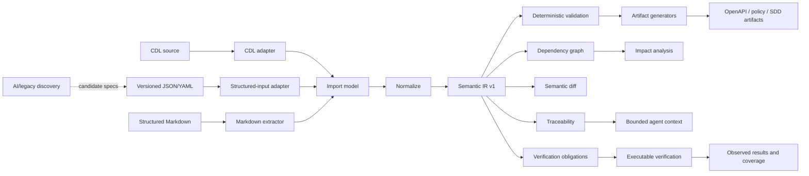
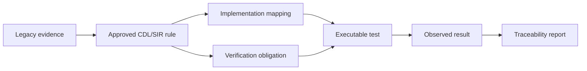

# CDL Architecture

## Product

CDL is a **Semantic Specification Compiler** for AI-driven software engineering. Its central product is a deterministic semantic core; the CDL language, Markdown, JSON and YAML are interfaces around that core.

> From business intent to verifiable software.

AI systems may discover or interpret candidate knowledge. Humans approve business meaning. CDL formalizes approved semantics and validates deterministic relationships. AI coding agents implement approved contracts, and executable tests independently verify behavior.

## Non-goals

CDL does not initially:

- Replace Markdown-based Spec-Driven Development.
- Require adoption of the CDL syntax.
- Own intent discovery.
- Depend on a particular AI model or agent harness.
- Generate complete applications.
- Claim behavioral equivalence from compilation or test coverage alone.
- Treat the bounded evaluator as a runtime, workflow engine or application execution platform.
- Extend the evaluator into a complete TM1 calculation engine without a separate approved proposal.
- Embed TM1-specific constructs in its semantic core.

## Target architecture



## Semantic Intermediate Representation (SIR)

SIR is the canonical semantic contract. It must be format-independent, versioned, deterministic and stable enough to support diff, impact and trace operations without reparsing source syntax.

### Required semantic objects

- Specification identity and version.
- Business intents.
- Domain entities, fields and type definitions.
- Typed parameter and expression models.
- Rules, calculations, constraints and invariants.
- Policies and approval state.
- Processes and semantic dependencies.
- Evidence, provenance and source locations.
- Implementation mappings.
- Acceptance scenarios and expected results.
- Verification obligations and observed statuses.
- Compatibility, migration and extension metadata.

### Design constraints

- Keep semantic payload separate from source formatting and display provenance.
- Use immutable values and deterministic ordering.
- Give every durable semantic object a stable identity.
- Preserve source references without letting them change semantic identity.
- Serialize canonically; equivalent input must produce byte-stable SIR.
- Reject incompatible versions or explicitly apply an approved migration.
- Reserve extension namespaces rather than silently accepting arbitrary fields.

The current `com.cdl.ir.IR` is lossy and not sufficient as the final SIR. Existing fields should be evaluated for reuse, with current behavior exposed through compatibility adapters.

## Structured expressions

Business expressions must be represented as typed expression nodes, never as opaque strings in SIR. A source adapter may preserve original text for provenance, but semantic operations consume the node structure.

Each expression node contains:

- A stable node kind and deterministic child ordering.
- Explicit semantic references to declarations, fields, parameters and rules.
- Operators, typed literals, function/application nodes and conditional branches.
- An inferred or declared result type, including unit/currency dimensions where applicable.
- Source locations for both the source spelling and normalized semantic identity.
- A precision/error policy reference when numeric or failure behavior is material.

Dependencies are collected from semantic references during normalization; parsers and consumers do not infer dependencies from text. The specification must separately define operator precedence, associativity, short-circuit behavior, missing-value propagation, coercion rules, numeric precision, rounding mode and explicit errors. No implicit coercion or approximate runtime behavior may be hidden in SIR.

SIR v1 should initially define a conservative, side-effect-free expression subset:

1. Typed literals and semantic references.
2. Unary and binary arithmetic with explicit overflow/division-by-zero behavior.
3. Boolean operators with defined short-circuiting.
4. Equality, ordering and typed null/missing-value comparisons.
5. Conditional expressions (`condition ? then : else` semantics, independent of source syntax).
6. A bounded set of approved deterministic built-ins.

### Initial expression semantic contract

Unless a later approved profile overrides it, the normalized expression contract is:

| Precedence | Operators | Associativity |
|---|---|---|
| 1 | semantic reference, literal, parenthesized expression | n/a |
| 2 | unary `+`, `-`, `not` | right |
| 3 | `*`, `/`, `%` | left |
| 4 | `+`, `-` | left |
| 5 | `<`, `<=`, `>`, `>=` | left, chaining rejected |
| 6 | `==`, `!=` | left, chaining rejected |
| 7 | `and` | left, short-circuit |
| 8 | `or` | left, short-circuit |
| 9 | conditional `condition then/else` | right |

- Types are checked before evaluation. There is no implicit numeric, string, unit or currency coercion.
- `and` and `or` evaluate only as needed. A conditional evaluates only its selected branch.
- Missing values are typed and are not identical to ordinary `null`; arithmetic or ordering with missing returns `missing` unless an explicit built-in handles it. Equality with another missing value of the same type is `true`; cross-type missing comparison is rejected.
- Decimal operations use the SIR decimal precision policy. The default remains **to be approved**; each evaluator input or rule set must declare scale, maximum precision, and rounding mode (`HALF_EVEN`, `HALF_UP`, `DOWN`, or another explicitly listed mode).
- Division by zero, decimal overflow, invalid dates, unresolved references and unsupported operations return typed errors; they never use host-language NaN/infinity or uncaught exceptions as semantics.
- Equality on decimal, currency and unit values requires type/dimension compatibility. Currency conversion and unit conversion are not implicit.
- An ordered decision rule set evaluates rules in declared order. The first matching rule returns its result; a no-match result or error must be declared explicitly. Simultaneous matches do not re-order rules or invoke AI judgment.

Unsupported expressions remain represented as explicitly unsupported source artifacts and cannot enter the bounded evaluator.

## Bounded reference evaluator

The P0 reference evaluator is an optional semantic tool, not a CDL runtime. It should evaluate only SIR expressions and ordered rule decisions that have complete, formally defined semantics.

The initial value set includes booleans, strings, exact decimal values, dates and explicitly typed missing values. The evaluator returns a structured outcome: `value`, `missing`, `rejected`, or `error`, plus rule ID, branch/reference trace and normalized error code. All arithmetic uses decimal semantics and an explicit precision/rounding policy; host floating-point values are not an implicit default.

A proposed developer command is:

```text
cdl evaluate RULE_ID --input values.json
```

Before committing this command to the v1 contract, a complexity spike must measure:

- Expression and value-model implementation size.
- Source-to-result diagnostic cost.
- Decimal/date dependency impact.
- Conformance-vector generation effort.
- Compatibility with ordered rules and explicit error handling.

The evaluator must not execute flows, call services, mutate state, launch workflows, load arbitrary code, evaluate unsupported TM1 formulas or claim application/legacy equivalence.

## Frontends

### Native CDL

The ANTLR grammar and parser remain the compatibility frontend. The existing syntax is additive-first: grammar changes require evidence that current metadata and statements cannot represent the needed semantics.

### JSON and YAML

JSON and YAML inputs must use an explicit, versioned schema. They are not interchangeable arbitrary containers; both normalize into the same SIR and obey deterministic ordering, scalar, unknown-field and provenance rules.

### Markdown SDD

Markdown remains human-readable and workflow-neutral. The compiler may consume structured sections whose schema is explicit, but arbitrary prose requires an upstream extraction or interpretation process. Markdown ownership is documented as either human-authored, generated or synchronized; one artifact cannot simultaneously own semantics in conflicting forms.

### Markdown-embedded CDL profile

An experimental interoperability profile may allow explicitly labeled fences, for example fenced blocks declared with the CDL language and a semantic profile attribute. The profile must preserve the Markdown document and record document URI, block identity, line/column range and content hash in SIR provenance.

The compiler processes only declared CDL blocks. Surrounding prose remains unchanged and is not treated as authoritative semantics. A formal rule is owned by exactly one SIR block; prose may explain or link to it but must not duplicate its normative definition. Diagnostics map back to the original Markdown source location.

Cross-document references use explicit stable document or semantic IDs and obey the same resolution and version rules as standalone CDL. A generated Markdown artifact must be marked generated and must not overwrite an owning human-authored block. The profile is adopted only after defining fence attributes, block identity, document discovery, partial-compilation behavior and conflict diagnostics.

## Deterministic semantic compiler

1. **Parse/import:** produce a source-aware import model.
2. **Normalize:** create canonical SIR.
3. **Resolve:** bind symbols and references.
4. **Type check:** validate declarations and typed expressions.
5. **Validate semantics:** check domain invariants, references, cycles, units and currencies.
6. **Validate evidence:** check provenance references and approval requirements.
7. **Build dependencies:** construct directed semantic relationships.
8. **Analyze evolution:** semantic diff and transitive impact.
9. **Generate obligations:** map rules and evidence to required verification.
10. **Project artifacts:** generate OpenAPI, policy and SDD artifacts from verified SIR.
11. **Verify drift:** compare canonical expectations to generated artifacts.

The compiler must be useful without LLM calls. Business ambiguity is reported as requiring interpretation or approval rather than hidden behind generated output.

## Lifecycle commands

Existing CLI names remain compatible. New behavior is added behind explicit commands or flags where changing legacy behavior could break consumers.

- `cdl validate`: deterministic diagnostics for syntax, references, types and semantics.
- `cdl diff`: semantic changes between two SIR documents.
- `cdl impact`: direct and transitive dependents of changed nodes.
- `cdl dependencies`: dependency graph export and prohibited-cycle checks.
- `cdl context`: bounded semantic context using relationships and approval/evidence filters.
- `cdl trace`: evidence, specification, implementation and verification links.
- `cdl verify`: verification status and artifact drift checks; it does not execute arbitrary application code by itself.
- `cdl coverage`: rule, evidence, scenario and verification obligation coverage.
- `cdl evaluate RULE_ID --input values.json`: evaluate the bounded reference subset when the V3 feasibility spike is accepted.

All commands should offer machine-readable output and stable non-zero exit codes.

## Compatibility architecture

Preserve these public surfaces during migration:

- `Compiler.compile(String)` and `Compiler.Result`.
- Existing CDL grammar and positional CLI commands.
- Existing OpenAPI golden outputs.
- Existing E001-E007 diagnostic identities.
- CTK fixtures and Docker usage.

The migration sequence is frontend/AST → SIR → legacy `IR` compatibility projection. Generators move from current lossy IR to verified SIR only after byte-level compatibility is established for existing CTK cases.

## Verification model



## Verification taxonomy

Verification results are reported as separate levels and must never collapse into a single “correct” score:

- **V1 — Structural validation:** syntax, schema, canonical form, required fields and source locations.
- **V2 — Semantic validation:** symbols, types, expression typing, dependencies, units/currencies, cycles and supported invariants.
- **V3 — Reference evaluation:** the bounded deterministic evaluator matches approved inputs and expected outcomes for the supported subset.
- **V4 — Implementation conformance:** an implementation agrees with approved reference cases and a declared conformance scope.
- **V5 — Legacy behavioral parity:** independently captured legacy observations agree for an explicitly bounded workload and policy.

V3 does not imply V4, V4 does not imply V5, and no level implies complete business correctness. Machine-readable reports should include level, scope, subject, evidence, status and limitations.

Compiler validation, test success and proven properties are separate outcomes:

- **Validated:** SIR conforms to deterministic rules.
- **Verified:** an executable test reports an observed result for an approved obligation.
- **Proven:** a bounded formal argument establishes a named property under explicit assumptions.
- **Coverage:** the percentage of linked obligations/scenarios, never complete behavioral equivalence by itself.

## TM1 adapter boundary

TM1 extraction and interpretation are optional adapters outside the core SIR implementation.

Initial deterministic extraction targets metadata and source text for cubes, dimensions, hierarchies, attributes, rules, feeders, dependencies, TurboIntegrator processes, chores, security policies, MDX and views. Each item retains source location, extraction method and confidence. Unsupported expressions remain explicit and AI-assisted interpretations remain provisional until human approval.

No public work may contain company data, credentials, proprietary models or confidential specifications.

## AI interoperability

SIR is the producer/consumer contract for agents. `context` returns bounded, relationship-aware semantic nodes including approved rules, types, dependencies, evidence, technical contracts, scenarios and obligations. Agent Skills and MCP are adapters; CDL must not depend on BitNet Agent Harness, Codex, Claude Code, OpenCode or any other agent system.

## Official CDL authoring skill

An experimental, model-independent authoring skill is P1 and lives alongside compiler documentation rather than inside the semantic engine. It teaches agents to:

- Select only constructs supported by the target CDL/SIR version.
- Preserve source evidence and locations.
- Label observed, documented and inferred behavior separately.
- Run `cdl validate` and report machine-readable diagnostics.
- Report unsupported expressions and unresolved business questions.
- Propose bounded verification scenarios without claiming approval or equivalence.
- Use the reference evaluator only within the declared V3 subset.

Initial examples cover lightweight extraction from Java decision logic and synthetic TM1 metadata/rules. The skill produces candidate semantic specifications for human review; it does not form an AI orchestration or intent-discovery engine.

## Property-based verification

Property-based verification is a future V3/V4 extension, after expression semantics and the bounded evaluator stabilize. The preferred approach is to integrate with a mature Java property-testing library selected during an approved dependency review, rather than build a generator engine.

Candidate uses include boundary generation from numeric/string/date domains, preservation of typed invariants and differential checks across reference and implementation evaluators. The compiler still requires explicit seed cases, deterministic generation configuration and reproducible counterexamples. This work is not a substitute for business scenarios or legacy parity evidence.

## Approval gates

Stop for human approval before:

- Breaking grammar changes.
- Major repository restructuring or compiler replacement.
- New runtime dependencies, including a property-testing library.
- Public SIR identity, versioning, expression semantics or compatibility commitments.
- Finalizing the bounded evaluator scope or promoting it beyond the approved subset.
- External/corporate TM1 access or a full calculation engine.
- Making extracted, generated or AI-assisted Markdown semantics authoritative.
- Benchmark publication.
