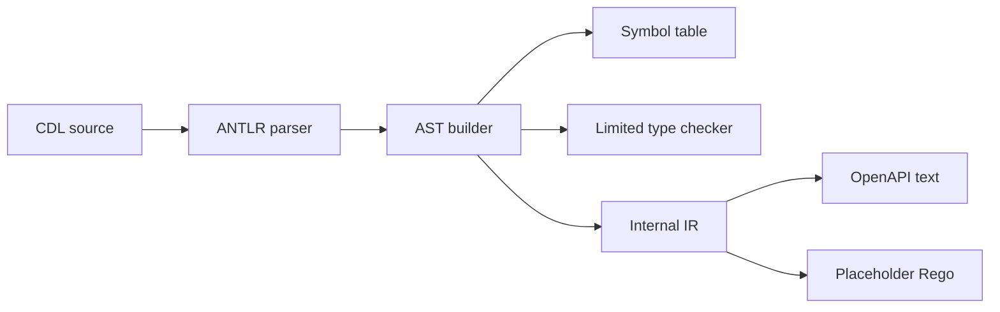
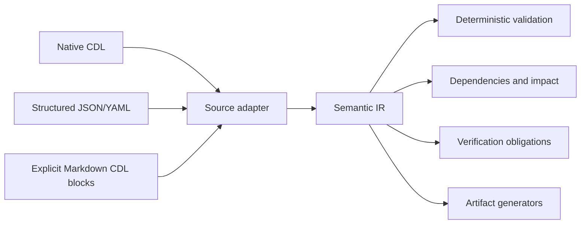

# Compiler Architecture

## Verified v0.6 pipeline

The current implementation is intentionally small:

- `Compiler.java` parses, builds an AST, runs the symbol and type components, creates an internal IR, then renders OpenAPI and Rego strings.
- `SymbolTable` stores top-level statements by identifier.
- `TypeChecker` performs limited field, parameter, constraint and type-cycle checks.
- `IR.java` contains types, intents and mappings only; rules, policies, flows and most provenance are not retained.
- Parser diagnostics are not reliably promoted to a failing compilation result.

## CDL 2.0 target

The architecture proposal places a versioned Semantic Intermediate Representation (SIR) at the center:

SIR, JSON/YAML adapters, semantic diff, dependency analysis, machine-readable diagnostics and reference evaluation are planned. They must not be represented as current v0.6 behavior.

See the repository [architecture proposal](https://github.com/pulsaride/cdl-lang/blob/master/ARCHITECTURE.md) and [strategic delta](https://github.com/pulsaride/cdl-lang/blob/master/governance/STRATEGIC-DELTA.md).
